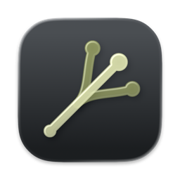
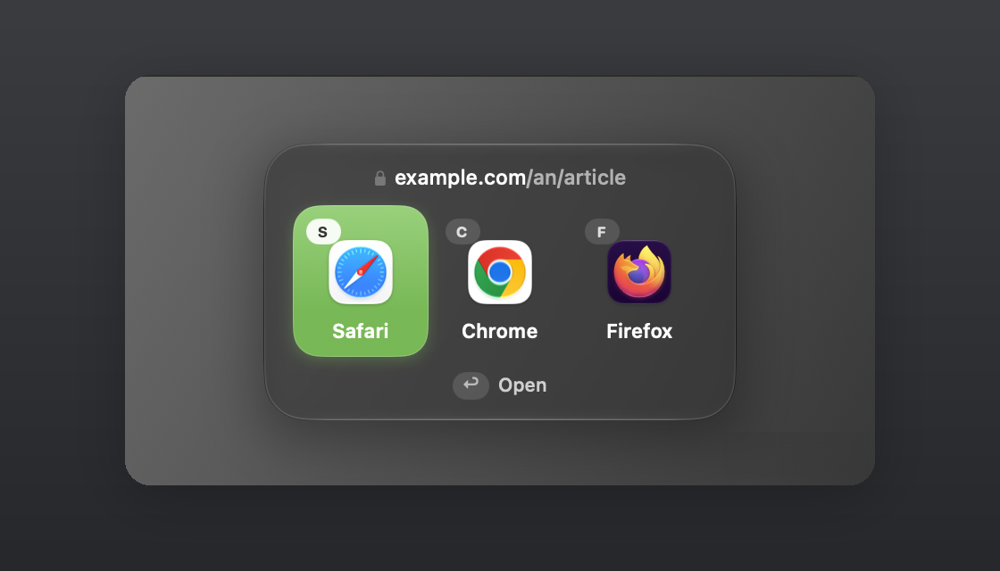
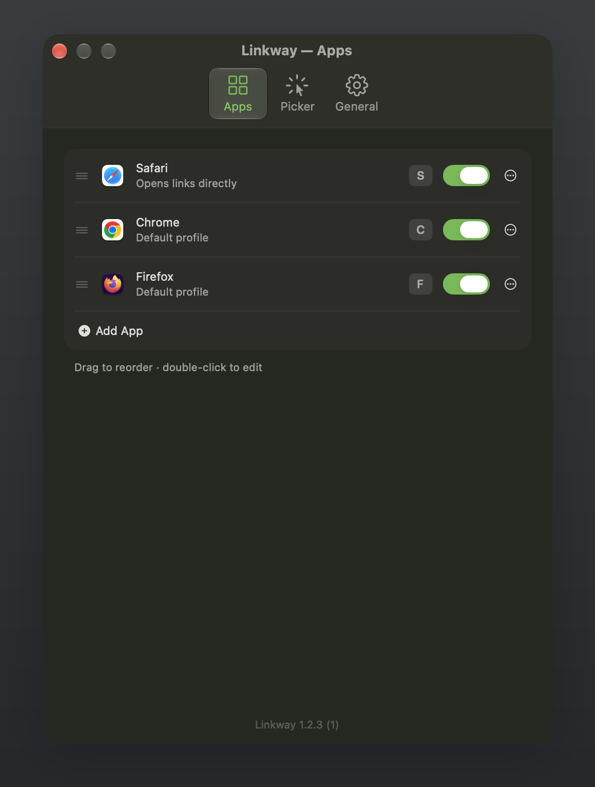
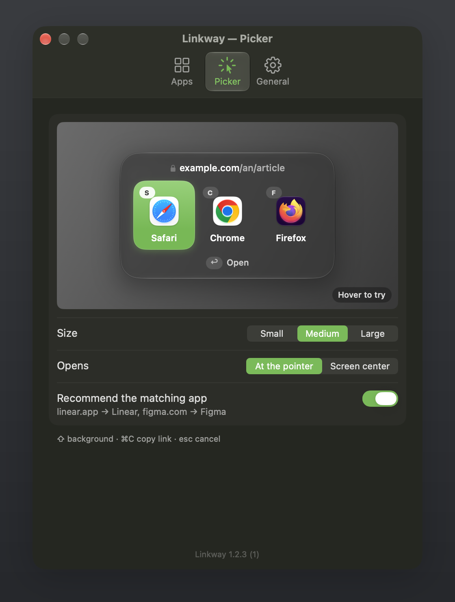
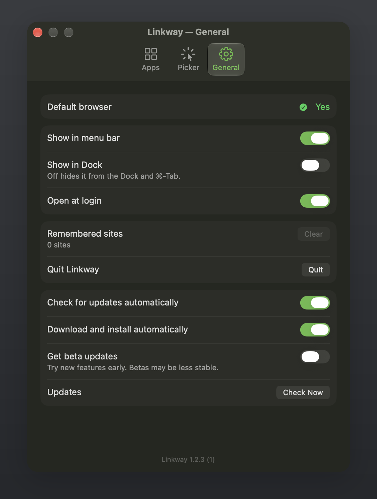

<p align="center">
  
</p>

<h1 align="center">Linkway</h1>

<p align="center">
  Every link you click, opened in the right browser, profile or app.
</p>

<p align="center">
  <a href="https://github.com/0-LY/linkway/releases/latest/download/Linkway.dmg"><b>Download Linkway for macOS</b></a>
  ·
  <a href="https://github.com/0-LY/linkway/releases">All releases</a>
</p>

<p align="center">
  
</p>

## What it does

Set Linkway as your default browser. Every link you click — in mail, chat, documents or the terminal —
opens a small picker right where you are, and you choose where it opens.

- Pick with a click, the arrow keys and ↩, the numbers 1–9, or each app's letter.
  ⇧ opens in the background, ⌘C copies the link, esc cancels.
- Recommends the app a link belongs to — a Figma link selects Figma — but only from apps in your list.
- Remembers the app you used last for each site and selects it next time.
- Chrome-family and Firefox profiles show up as separate choices.
- Add, remove, reorder, rename and hide apps, set shortcut letters, picker size and position.

<p align="center">
  
  
  
</p>

## Install

> [!IMPORTANT]
> **First install only.** Linkway isn't notarized by Apple, so macOS blocks it the first time.
> You may see this twice — once for the `.dmg`, once for the app. Each time: click **Done**, open
> **System Settings → Privacy & Security**, scroll down and click **Open Anyway** next to "Linkway",
> then open it again. You do this once per app; updates install and open normally.

1. [Download Linkway.dmg](https://github.com/0-LY/linkway/releases/latest/download/Linkway.dmg) and open it. If macOS blocks it, use **Open Anyway** as above.
2. Drag **Linkway** onto the **Applications** folder in the window that opens.
3. Open Linkway from Applications. If macOS blocks it, use **Open Anyway** again.
4. In Linkway's settings click **Make Default** and confirm.
   To start it with your Mac, turn on **Open at login** in Settings → General.
5. Optional: to list browser profiles separately, allow **Full Disk Access**
   (System Settings → Privacy & Security → Full Disk Access). Linkway only reads the browsers' profile lists.

Requirements: macOS 26 or later on Apple silicon.

## Privacy

- Linkway makes no network connections of its own, apart from checking for updates.
- No account, no analytics, no tracking.
- It only opens normal `http` and `https` links; anything else is ignored.
- Per-site history stores only the site name (for example `example.com`) and the app you picked — never full links.
- Settings and history live in `~/.config/linkway/`, readable only by you.
- With Full Disk Access, Linkway reads only Chrome's and Firefox's profile lists — never cookies, history or passwords.
- Update checks fetch `https://github.com/0-LY/linkway/releases/latest/download/appcast.xml`. No system profile is sent.

## Updates

Linkway updates itself. Every update is signed, and Linkway refuses any download whose signature doesn't match the key built into the app.

In **Settings → General** you can turn off automatic checks or automatic installs, check now, or switch on
**Get beta updates** to try new features early.

## Build from source

```sh
git clone https://github.com/0-LY/linkway.git
cd linkway
./build.sh                # installs to ~/Applications
./build.sh /Applications  # or another folder
```

You need the Xcode Command Line Tools (`xcode-select --install`). The first build downloads Sparkle
(pinned version, checked against its SHA-256).

| Path | Purpose |
|---|---|
| `Sources/main.swift` | App, link handling, picker window |
| `Sources/Picker.swift` | The picker |
| `Sources/Catalog.swift` | Apps, profiles, recommendations, history |
| `Sources/Settings.swift` | Settings window |
| `Sources/Updates.swift` | Automatic updates (Sparkle) |
| `Sources/Identity.swift` | Name, bundle ID and settings folder, read from the built app |
| `Resources/` | Info.plist template and entitlements |
| `app.env` | Name, publisher, GitHub owner and repo, version |
| `scripts/` | Build and Sparkle download scripts; `scripts/icon/` makes the app icon |

## Credits

Updates: [Sparkle](https://sparkle-project.org) (MIT).

## License

[MIT](LICENSE) © 0-LY
